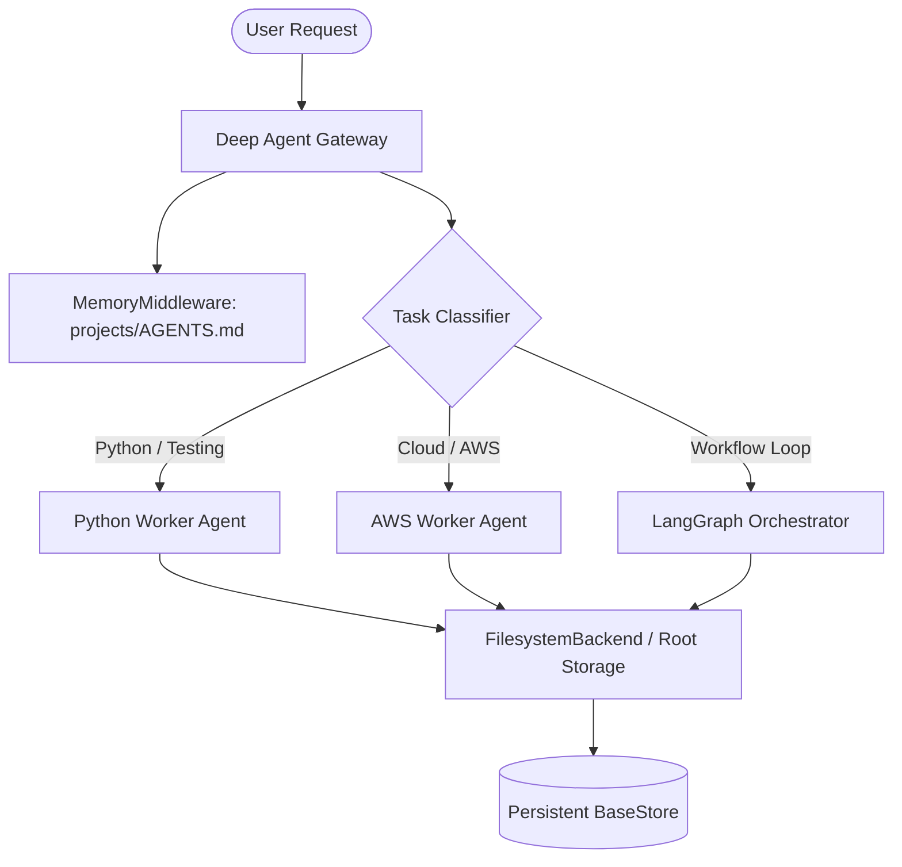

# Technical Writing Skill — Production Examples

This document provides production-ready documentation templates and real-world writing artifacts across different Diátaxis categories.

---

## Example 1: Production Open-Source / Enterprise `README.md` Template

Demonstrates project badges, value proposition, architecture diagram, quickstart, configuration, and developer commands.

````markdown
# Deep Agents Core

[](https://github.com/amareshgit/DeepAgent/actions)
[](https://www.python.org/downloads/)
[](https://opensource.org/licenses/MIT)

**Deep Agents Core** is an enterprise-grade agentic orchestration framework designed for long-horizon autonomous coding, analysis, and cloud infrastructure tasks. Built on LangGraph, it couples modular middleware with isolated filesystem backends and durable memory subsystems.

---

## Architecture Overview



---

## Features

- **Context Isolation**: Isolate long-running search and execution tasks into specialized subagents without polluting primary chat tokens.
- **Durable Memory (`AGENTS.md`)**: Automatically loads and self-updates persistent operating directives across threads.
- **Pluggable Backends**: Switch effortlessly between virtual in-memory filesystems, local disk root directories, and cross-thread `BaseStore` backends.

---

## Quickstart

### 1. Installation

Install the package via `uv` or `pip`:

```bash
uv pip install deepagents langchain-openai
```

### 2. Basic Agent Invocation

Create an agent with local disk access and persistent memory:

```python
from deepagents import create_deep_agent
from deepagents.backends import FilesystemBackend

# Initialize filesystem backend rooted in current workspace
backend = FilesystemBackend(root_dir=".", virtual_mode=True)

agent = create_deep_agent(
    model="openai:gpt-4o",
    backend=backend,
    memory=["projects/AGENTS.md"],
)

response = agent.invoke({
    "messages": [{"role": "user", "content": "Analyze repository architecture and suggest improvements."}]
})

print(response["messages"][-1].content)
```

---

## Configuration

Configure the agent runtime via environment variables:

| Variable | Required | Default | Description |
|---|---|---|---|
| `OPENAI_API_KEY` | Yes | — | OpenAI authentication token |
| `DEEPAGENT_LOG_LEVEL` | No | `INFO` | Logging verbosity (`DEBUG`, `INFO`, `WARNING`) |
| `DEEPAGENT_ROOT_DIR` | No | `.` | Root directory for workspace file operations |

---

## Contributing

1. Clone the repository: `git clone https://github.com/amareshgit/DeepAgent.git`
2. Install dependencies: `uv sync`
3. Run tests: `pytest tests/`
4. Lint code: `ruff check .`
````

---

## Example 2: Architectural Decision Record (ADR)

Demonstrates the MADR (Markdown Architectural Decision Record) structure capturing technical tradeoffs, context, and consequences.

```markdown
# ADR-004: Adoption of LangGraph for Stateful Multi-Agent Workflows

- **Status**: Accepted
- **Deciders**: AI Architecture Team, Lead Cloud Engineer
- **Date**: 2026-09-20
- **Technical Story**: Issue #104 — Transitioning from linear chains to cyclic agent reasoning loops

---

## Context and Problem Statement

Our autonomous agents frequently require multi-turn tool execution, reflection, self-correction, and human approval gates. Our legacy implementation relied on linear LangChain execution chains, which made cyclic looping fragile, prevented fine-grained state rollbacks, and lacked a deterministic checkpointer mechanism for cross-session resumption.

We need an orchestration engine that provides:
1. First-class cyclic graph topologies with loop guardrails.
2. Fine-grained channel state reducers.
3. Durable persistence and time-travel capability.
4. Native support for human-in-the-loop pause and resume.

---

## Decision Drivers

- **Cyclic Execution**: Agents must be able to inspect code output, encounter test failures, and route back to the coder node without breaking execution context.
- **Persistence**: Long-running background jobs require persisting checkpoints to PostgreSQL or SQLite.
- **Developer Experience**: Graph definitions must be clear, typed, and testable using standard Python syntax.
- **Minimal Vendor Lock-in**: The solution should run on standard cloud compute without proprietary cloud runtimes.

---

## Considered Options

1. **Option 1: LangGraph (StateGraph)**
2. **Option 2: Custom In-House While-Loop State Machine**
3. **Option 3: Temporal / Cadence Workflow Engine**

---

## Decision Outcome

**Chosen Option: Option 1 (LangGraph)**.

LangGraph provides native support for `StateGraph`, channel reducers, conditional branching, and `MemorySaver`/`PostgresSaver` checkpointers, while maintaining full compatibility with our existing LangChain tool ecosystem.

### Positive Consequences
- Unified state model with explicit typing (`TypedDict` and Pydantic).
- Out-of-the-box support for Human-in-the-Loop interruptions via `interrupt()`.
- Built-in time travel allows reproducing and debugging failed agent trajectories.

### Negative Consequences / Tradeoffs
- Additional learning curve for engineers accustomed to linear chains.
- State schema design requires upfront rigor to avoid channel merge conflicts.

---

## Pros and Cons of the Options

### Option 1: LangGraph
- Good: Native cyclic graph model, rich checkpointer ecosystem, first-class LangSmith tracing.
- Bad: Emerging API updates require active dependency tracking.

### Option 2: Custom In-House State Machine
- Good: Zero new third-party dependencies.
- Bad: High maintenance overhead; reinvents persistence, checkpoints, and streaming.

### Option 3: Temporal
- Good: Unmatched durability for distributed enterprise jobs.
- Bad: Heavy infrastructure overhead (cluster setup) unsuitable for lightweight embedded agent workflows.
```

---

## Example 3: Comprehensive API Reference & Developer Guide

Demonstrates reference-style documentation for an HTTP endpoint with request/response schema, headers, and status code catalog.

````markdown
# API Reference: Batch Analysis Ingestion

Initiate an asynchronous batch analysis across repository files using configured Deep Agent workers.

```http
POST /api/v1/agents/analysis-jobs
Content-Type: application/json
Authorization: Bearer <token>
```

---

## Request Parameters

### Headers

| Header | Type | Required | Description |
|---|---|---|---|
| `Authorization` | `string` | Yes | Bearer token formatted as `Bearer <api_key>`. |
| `X-Correlation-ID` | `string` | No | Unique client tracing identifier. |

### Request Body Schema

```json
{
  "target_paths": [
    "src/core/pipeline.py",
    "src/utils/helpers.py"
  ],
  "agent_profile": "python_reviewer",
  "concurrency_limit": 4,
  "options": {
    "include_ast_lint": true,
    "max_runtime_seconds": 120
  }
}
```

| Field | Type | Required | Description |
|---|---|---|---|
| `target_paths` | `array[string]` | Yes | Array of relative file paths to analyze. Maximum 25 paths. |
| `agent_profile` | `string` | Yes | Name of specialized agent profile (`python_reviewer`, `security_auditor`). |
| `concurrency_limit` | `integer` | No | Maximum parallel workers. Default `2`. Max `8`. |
| `options.include_ast_lint` | `boolean` | No | When true, includes static AST linting prior to LLM evaluation. Default `true`. |

---

## Responses

### 202 Accepted — Job Queued

```json
{
  "job_id": "job_948fbc2e-18ad-4a6f-b258-75c12093a11b",
  "status": "QUEUED",
  "created_at": "2026-09-20T12:00:00Z",
  "estimated_duration_seconds": 45,
  "links": {
    "status_url": "/api/v1/agents/analysis-jobs/job_948fbc2e-18ad-4a6f-b258-75c12093a11b"
  }
}
```

### Error Responses

| Status Code | Error Code | Description | Resolution |
|---|---|---|---|
| `400 Bad Request` | `INVALID_PATH_FORMAT` | One or more file paths contain invalid path traversal sequences (`..`). | Verify all paths are relative to repository root. |
| `401 Unauthorized` | `INVALID_CREDENTIALS` | Bearer token is expired or invalid. | Regenerate your API key in the developer console. |
| `429 Too Many Requests` | `RATE_LIMIT_EXCEEDED` | Exceeded 50 jobs per minute quota. | Implement exponential backoff and retry after `Retry-After` seconds. |
````

---

## Example 4: Step-by-Step How-To Guide

Demonstrates goal-oriented procedural instructions with prerequisites, verification steps, and troubleshooting callouts.

````markdown
# How to Mount a Persistent File Storage Backend in Deep Agents

This guide explains how to connect a `FilesystemBackend` to a Deep Agent to enable safe, isolated file reads and writes on disk.

---

## Prerequisites

- Python 3.11 or later installed.
- Deep Agents library installed: `uv pip install deepagents`.
- Read and write permissions for your target workspace directory.

---

## Step 1: Define Your Target Storage Directory

Create a dedicated workspace folder to prevent accidental modification of root system files:

```bash
mkdir -p /tmp/agent_workspace/projects
```

---

## Step 2: Initialize FilesystemBackend with Virtual Isolation

Instantiate `FilesystemBackend` with `virtual_mode=True`. This locks the agent into your specified root directory and prevents path-traversal attacks (`../`):

```python
from pathlib import Path
from deepagents.backends import FilesystemBackend

workspace_path = Path("/tmp/agent_workspace").resolve()
backend = FilesystemBackend(root_dir=str(workspace_path), virtual_mode=True)
```

> [!IMPORTANT]
> Setting `virtual_mode=True` is strongly recommended in multi-tenant or automated environments to enforce sandboxing boundaries.

---

## Step 3: Instantiate and Test the Agent

Bind the backend to your agent and perform a test file creation:

```python
from deepagents import create_deep_agent

agent = create_deep_agent(
    model="openai:gpt-4o",
    backend=backend,
)

result = agent.invoke({
    "messages": [
        {"role": "user", "content": "Create a file named hello.txt containing 'Hello from Deep Agent'"}
    ]
})
```

---

## Step 4: Verify the Results

Verify that the file was created on disk within the isolated workspace:

```bash
cat /tmp/agent_workspace/hello.txt
```

Expected output:
```text
Hello from Deep Agent
```

---

## Troubleshooting

### Issue: `PermissionError: Escaping root directory`
- **Cause**: The agent attempted to write using an absolute path or a relative path containing `..`.
- **Solution**: Ensure your agent system prompt instructs the agent to use relative paths anchored to the root directory.
````
